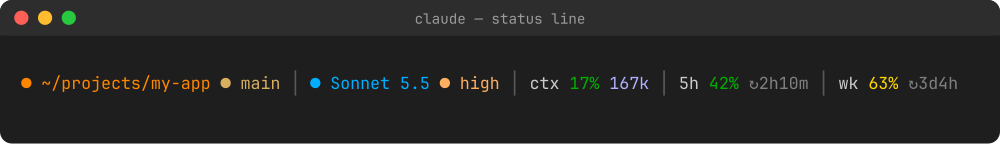
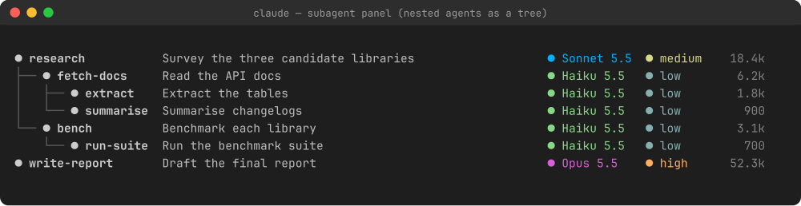

# claude-statusline

A status line and a subagent panel for [Claude Code](https://claude.com/claude-code): your usage, model and effort always in view, and every subagent with its own model and effort.



**Status line**: directory, git branch, model + effort, context (percentage and absolute tokens, in the colour `/context` uses), 5-hour and weekly usage with time until reset.



**Subagent panel**: one row per subagent with name, description, model, effort and tokens. Nested agents are drawn as a tree when the [agent-tree](https://github.com/Lucasbk38/claude-agent-tree) mod is installed (it provides the parent links); without it the rows are flat.

## Install

macOS / Linux:

```sh
curl -fsSL https://raw.githubusercontent.com/Lucasbk38/claude-statusline/main/install.sh | sh
```

Windows: run the same line in Git Bash or WSL. Needs `sh`, `curl`, `jq` and `git`; icons need a [Nerd Font](https://www.nerdfonts.com/) in your terminal.

The installer copies the scripts to `~/.claude/statusline/` and sets `statusLine` and `subagentStatusLine` in `~/.claude/settings.json` (backup: `settings.json.bak`).

## Customise

Colours and icons for models and effort levels live in `~/.claude/statusline/theme.json`; both scripts read it. The images are rendered from the scripts' real output with sample data.

MIT licensed.
